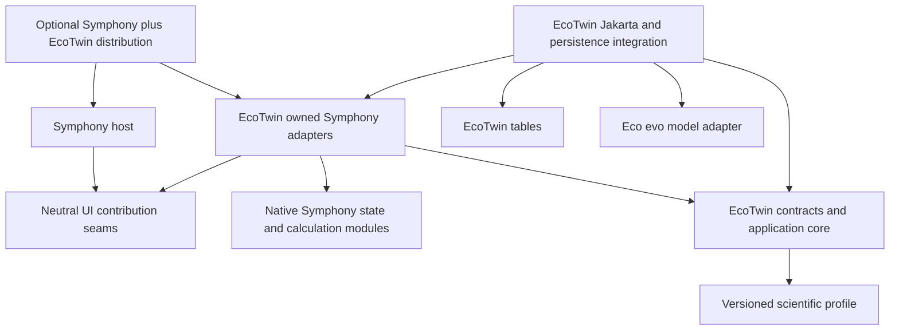

# EcoTwin plugin restructuring plan

Status: implemented and verified, 2026-10-27. See the [implementation review guide](ECOTWIN-PLUGIN-IMPLEMENTATION.md) for delivered modules, verification evidence and retained limits. The assessment below preserves the pre-refactor review at `9243932` and the approved migration design.

Make EcoTwin an optional, separately owned module with a **Symphony adapter maintained by EcoTwin**. Keep the initial deployment inside the Symphony frontend and backend WAR, preserving integrated maps, reports, authentication and transactions. Isolate the implementation and its tests first; make separate deployment a later decision.

The governing rule is: **Symphony may evolve normally. EcoTwin adapts through its adapter and a small, explicit host integration patch.** Symphony should not import simulation domain types, understand ensemble jobs, or preserve internal structures for EcoTwin. A plugin release supports particular Symphony revisions; it does not make the base application responsible for plugin compatibility.

## 1. Review scope and baseline

The comparison is original Symphony `6e9a3f218b5a444ca12daae72fe91204a606c384` to this branch at `9243932`.

- `6e9a3f2` is local `origin/develop` and the `havochvatten/MSP-Symphony` upstream `develop` head checked through GitHub during this review.
- Fork `main` is `e2c6d3a` and already includes earlier MARELD/EcoTwin work. Comparing only against it would miss substantial integration and research infrastructure.
- The full review includes the earlier prototype/cleanup, saved-calculation rewrite, and latest ensemble/comparison additions. It covers both changes to original files and newly added files that depend on original internals.
- [The complete change inventory](ECOTWIN-PLUGIN-INVENTORY.md) assigns a proposed treatment to every changed path.

| Area | Files changed | Added | Original files modified |
| --- | ---: | ---: | ---: |
| Research and sample data | 101 | 101 | 0 |
| Frontend feature modules | 60 | 60 | 0 |
| Frontend host, configuration and tests | 32 | 1 | 31 |
| Backend | 35 | 31 | 4 |
| Database migrations | 3 | 3 | 0 |
| Scripts | 14 | 14 | 0 |
| Documentation and root files | 10 | 8 | 2 |
| **Total** | **255** | **218** | **37** |

The backend additions include 22 production Java classes and nine test classes. The 101 data files account for approximately 6.50 MB of the 7.41 MB of current Git blob contents across changed paths. These are content sizes, not deployment sizes. Large downloaded source datasets are separately ignored.

Neither frontend dependency manifests, the backend POM, nor existing CI workflows changed in this delta. There is currently no independently buildable plugin artifact. Existing domain/workflow documentation provides the vocabulary; the repository has no `CONTEXT.md` or ADR collection establishing a different architecture.

## 2. Assessment of the current implementation

### Useful separation already exists

Most feature implementation is additive. Native NgRx reducers/actions were not changed. The map bridge owns a distinct layer group and disposes its layers. Saved summaries and tensor artifacts are separate, and reports fetch persisted summaries/final frames independently of an active editor or model server. Simulation tables have outward references to native calculations; native entity classes do not acquire simulation collections.

Keep these properties. The main problem is **dependency direction**, followed by build optionality and ownership. Moving files alone would leave those problems intact.

### Findings that determine the design

| Finding | Evidence in the current tree | Consequence |
| --- | --- | --- |
| The feature flag is not an installation switch | Production disables `mareldPoc`, but [calculation report HTML](https://github.com/hci-gu/MSP-Symphony/blob/9243932/frontend/src/app/report/calculation-report.component.html) still mounts the appendix. [CalculationReportModal](https://github.com/hci-gu/MSP-Symphony/blob/9243932/frontend/src/app/shared/report-modal/calculation-report-modal.component.ts) waits unconditionally for `simulationAppendixState`. | A base server without simulation endpoints can leave ordinary calculation printing unavailable. Treat absence, reporting-only and execution as distinct modes. |
| Host UI knows feature internals | Main view/map modules import concrete feature modules; [MapComponent](https://github.com/hci-gu/MSP-Symphony/blob/9243932/frontend/src/app/map-view/map/map.component.ts) injects `MareldMapBridge`; comparison and report code use simulation selection/query/token rules. | A plugin rename, lifecycle change or report change requires native edits. Replace these dependencies with small neutral contribution seams. |
| The existing frontend adapter is incomplete | [SymphonyCalculationAdapter](https://github.com/hci-gu/MSP-Symphony/blob/9243932/frontend/src/app/features/mareld-poc/symphony-calculation.adapter.ts) exposes `CalculationSlice` and dispatches native actions. [MareldSession](https://github.com/hci-gu/MSP-Symphony/blob/9243932/frontend/src/app/features/mareld-poc/mareld-session.service.ts) directly subscribes to native logout/deletion actions. | Native state changes propagate through plugin application code. Concentrate native types, actions and configuration in the adapter. |
| Native input reconstruction is the deepest coupling | [CalculationInputService](https://github.com/hci-gu/MSP-Symphony/blob/9243932/symphony-ws/src/main/java/se/havochvatten/symphony/service/CalculationInputService.java) uses native entities, scenario application, `MatrixMask`, source files, CRS and pixel rounding. | This implementation must track Symphony semantics. It belongs to the plugin's Symphony adapter, supported by native-equivalence tests. |
| Persistence depends on same-database coordination | [SimulationJobService](https://github.com/hci-gu/MSP-Symphony/blob/9243932/symphony-ws/src/main/java/se/havochvatten/symphony/service/SimulationJobService.java), [SimulationRunService](https://github.com/hci-gu/MSP-Symphony/blob/9243932/symphony-ws/src/main/java/se/havochvatten/symphony/service/SimulationRunService.java) and baseline creation coordinate native calculation locks and plugin writes. | Premature extraction to another process would replace working transactions with a new consistency protocol. |
| Model/profile policy looks like general host functionality | `CalculationInputService.validateGrid` restricts grids to EPSG:3035/1 km/3–60 cells. [SimulationRunValidation](https://github.com/hci-gu/MSP-Symphony/blob/9243932/symphony-ws/src/main/java/se/havochvatten/symphony/service/SimulationRunValidation.java) embeds the reviewed West baseline, hashes and pressure transforms. | Keep native interpretation in the adapter and scientific restrictions in a versioned EcoTwin profile. Neither becomes a universal Symphony rule. |
| Build and development setup import the feature | Both environment files and [proxy.conf.js](https://github.com/hci-gu/MSP-Symphony/blob/9243932/frontend/proxy.conf.js) import `mareld-shared/run-config`. | Deleting the feature directory breaks base setup even when disabled. Optional composition must own these imports. |
| Current CI does not prove isolation | Existing frontend workflow targets `develop`; backend PR workflow also targets `develop`. No absent-plugin build/deployment lane exists. | A green unit suite does not prove the fork's default workflow or optional deployment works. Add explicit distribution/compatibility checks. |

The current map bridge is instantiated even when it is not attached, because native MapComponent injects it and it injects the root session. That constructs feature listeners; it does not itself imply that the model executes. This distinction matters when defining the absence test.

## 3. Target architecture and ownership

Use a small number of modules with substantial behavior behind their interfaces. Here, an interface includes lifecycle, authorization, failure and transaction requirements, not just method signatures. A seam is the place where an adapter absorbs change.



Arrows represent dependencies. The distribution is allowed to know both products. Native host modules must not depend on EcoTwin implementation. The Symphony adapter is allowed to depend on native internals and is where compatibility repairs belong.

A practical source layout is:

```text
plugins/ecotwin/
  contracts/                 wire schemas, versions and cross-language fixtures
  profiles/hav-west-native-v1/
  frontend/
    domain/                  grid, tensor, biomass and comparison rules
    application/             workspace facade, jobs, history, notifications
    ui/                      controls, graphs and report rendering
    integration/symphony/    NgRx, navigation, host UI and map adapters
    public-api.ts            registration and supported exports only
  backend/
    core/                    host-independent requests, results and ensemble math
    integration/symphony/    native access, export, verification and baselines
    integration/jakarta/    REST, transactions, persistence and worker lifecycle
    integration/ecoevo/     engine request/response protocol
  migrations/
  tools/                     support installation and integration verification
  docs/
distributions/symphony-ecotwin/
  frontend/                  optional registration, config and dev proxy composition
  backend/                   explicit opt-in WAR composition
  compatibility/             supported revisions and small host patch inventory
examples/ecotwin/             optional datasets, Poseidon and research tooling
```

These are ownership directories, not a requirement to create a package for every folder. Start with one frontend package, one backend core artifact and the integration sources required by the composed WAR. Add artifacts only where independent builds or release ownership justify them.

### Enforced dependency rules

1. EcoTwin domain/application code must not import native `@data`, host environments, map/report implementations or `se.havochvatten.symphony.*` classes. Backend core also has no JPA, servlet, EJB or GeoTools dependency.
2. Only `integration/symphony` imports native entities, actions, selectors, services and route conventions. Its allowed dependencies are recorded individually, not as a blanket exemption for the host tree.
3. Jakarta persistence/transport modules depend on plugin contracts and adapter operations. ORM records do not become the model client's or numerical core's interface.
4. Host source references only neutral extension interfaces. The optional composition entry is the one intended host/distribution-to-plugin dependency.
5. Sample datasets and live credentials are not required to compile the base or plugin, run ordinary contract tests, or start the application.
6. Shared contract types live in the plugin contracts module. An HTTP implementation such as `SimulationReportData` must not own the types used by every other module.

Use import/build checks to enforce these rules. A naming convention or a folder named `plugin` is insufficient.

### Why keep the first version in process

| Option | Fit for this code | Recommendation |
| --- | --- | --- |
| Optional module in the current frontend/WAR | Preserves native map/report experience, servlet authentication, JTA and native input semantics. Requires a small maintained host patch. | **Implement first.** |
| Separate companion application/service | Can leave upstream UI untouched, but loses embedded workflow unless hooks are added anyway. Requires authorization delegation, calculation deletion/late-result handling and cross-service baseline creation. | Consider when independent deployment is an actual requirement. |
| Runtime-loaded frontend microfrontend/plugin framework | Does not solve native input or persistence coupling; adds framework/runtime compatibility work. | Defer. A build-time optional contribution is sufficient. |

There is no zero-patch embedded-plugin mechanism in the reviewed base. A small neutral hook patch must be maintained by the distribution until upstream chooses to accept it. Upstream acceptance is useful, but it must not block this restructuring. Same-process modularity also does not provide crash/resource isolation; separate execution/storage would be a distinct architectural project.

## 4. Frontend restructuring

### 4.1 Introduce only the four demonstrated host seams

| Seam | What the host supplies or accepts | What EcoTwin owns |
| --- | --- | --- |
| Workspace contribution | Sidebar/overlay mount locations; generic contribution ID; activation, visibility and disposal lifecycle | EcoTwin tab, controls, result tray, graph panel and workspace state |
| Map contribution | An owned overlay lease/group location, map projection, usable viewport/occlusion and fit/dispose operations | OpenLayers raster/outline rendering, color scales and playback |
| Comparison contribution | Native calculation pair, implied-baseline/reverse context; optional extra controls and validation; opaque report-link contribution | Run selection, compatibility, preparation links and pinned run identities |
| Report contribution | Calculation/comparison context, appendix outlet and aggregate render readiness | Saved simulation data, figures, plugin URL parsing and report-specific state |

The concrete interfaces should be implemented against these existing uses, with an empty provider and the EcoTwin provider as the first two real cases. Do not invent a marketplace, discovery language or universal map abstraction.

Prove sidebar composition in an early UI spike. The current `SlideViewComponent` finds directly projected tabs through `@ContentChildren(SlideViewTabComponent)`. A tab hidden inside a dynamically mounted plugin component will not automatically participate. Prefer host-rendered tab descriptors/templates or an explicit registration path; verify initial-tab navigation, activation, sidebar hiding and destruction before migrating the workspace.

Native comparison remains usable with an empty contribution. If the user explicitly selects a simulation comparison, that contribution may prevent submitting an incomplete pair; the host sees generic validation, not simulation rules.

A map adapter may use OpenLayers directly. Its interface should lease the necessary host facilities rather than exposing the complete native MapComponent or wrapping all of OpenLayers. Remove dependence on native layer index 3, arbitrary layer ordering, fixed sidebar padding and parent DOM geometry. Preserve the dedicated layer group and resource disposal already implemented.

### 4.2 Move host knowledge into the adapter

Translate native `CalculationSlice` into a plugin-owned calculation choice. Keep NgRx actions/selectors, baseline-switch behavior, login/logout, deletion notifications and environment lookup entirely in `integration/symphony`.

The current deletion listener reacts to deletion commands, before confirmed deletion. Record and preserve that behavior during the mechanical move; decide separately whether confirmation-based invalidation is preferable. A refactor must not silently change stale-response, cache or authorization cleanup timing.

The adapter owns existing route/query conventions, including `tab=mareld-poc`, calculation selection and comparison preparation. Give internal modules EcoTwin names; keep legacy URLs/config aliases while callers migrate.

### 4.3 Keep a cohesive workspace facade

`MareldSession` is 752 lines, but its size alone is not the reason to split it. It coordinates invariants across preparation, preview cancellation, uncertain submissions, caches, history and playback.

Keep one public `SimulationWorkspace` facade for the UI. Internally separate calculation preparation/cache, durable job submission/history, and ephemeral playback only where their lifecycles differ. Keep revision guards, uncertain request identity and deletion tombstones with the state they protect. Tests should exercise the facade's behavior rather than reproducing its internal method structure.

Extract a plugin notifications module to own same-tab events, BroadcastChannel messages, focus refresh and disposal. Current session, persistence, appendix, comparison picker and comparison report repeat this logic. Notifications invalidate data; they never authorize it. Clear account-specific caches/subscriptions on logout.

### 4.4 Make reports independent contributions

Remove simulation-specific types, query parsing and message names from native report components/modals. EcoTwin's adapter interprets `simBase`, `simBaselineRun`, `simScenarioRun` and the legacy preparation URL, and contributes rendering/link state opaquely to the host.

Introduce one generic report readiness protocol. It must:

- Identify the current report document and contribution set, not just a calculation number.
- Validate iframe source and origin, and reject stale pair/document messages.
- Wait for native report content/images/fonts plus installed, selected contributions.
- Become ready for a native report when there are no contributions.
- Invalidate readiness when the selected artifact disappears or the report context changes.

Keep absent, unavailable and empty distinct. An absent plugin produces an ordinary native report with no simulation requests. An installed contribution that fails must show an explicit unavailable state; it must not quietly convert failure into an empty successful appendix. Any native-only print action for a requested extension must make the omission explicit.

New extended report URLs should carry a generic required-extension marker, such as `requiresExtension=ecotwin`, so the host can identify an unavailable extension without understanding run IDs. Supported distributions must retain small compatibility metadata that maps old `simBase`/`simBaselineRun`/`simScenarioRun` links to that requirement, even when the implementation is omitted. This metadata belongs to the distribution, not native report logic. A completely bare upstream build without that metadata cannot recognize legacy plugin-specific links; do not promise legacy extended-report detection in that build.

Preserve the existing strong report properties: read persisted summaries/final frames only; no engine dependency; no active workspace requirement; exact run IDs; explicit missing-run state; reversed implied comparisons; unchanged native CSV/GeoTIFF URLs. Generic asynchronous print asset waiting and expandable page layout can remain native improvements.

### 4.5 Define installation and capability modes

| Mode | Required behavior |
| --- | --- |
| Plugin absent | No plugin implementation/providers in the build, no endpoints/entities/timers in the WAR, no tables or sidecars required. Native reports and printing work. Distribution compatibility metadata may remain to identify legacy links that require an unavailable extension. |
| Plugin installed, execution disabled | Saved artifacts and reports remain readable with valid native authorization. No discovery/preview/job execution. Existing jobs are preserved for an explicit later resume. |
| Plugin enabled | Validated profile/model capabilities enable input preparation, preview and jobs; reporting remains independent. |

Use plugin-owned configuration and a capability response rather than interpreting an empty URL as the complete installation state. Distinguish an unsupported native adapter, missing profile support, unavailable model and forbidden access. For an unverified adapter version, do not assume authorization or input semantics remain valid; enable only capabilities whose contracts pass.

Consolidate model discovery and execution behind the plugin backend's configured model endpoint. Today discovery uses `/mareld-api` while execution uses `ECOTWIN_API_URL`, creating two configurations that must agree. Keep temporary aliases and preserve model information/error behavior during this change.

## 5. Backend restructuring

### 5.1 Extract a host-independent core

Move ensemble statistics, tensor encoding/validation, frozen configuration, run identity and checkpoint rules behind plugin-owned contracts. Use an immutable execution request/checkpoint DTO instead of passing the JPA `SimulationJob` into the worker/model protocol.

Separate prepared-request validation from completed-result validation. Today submission creates a synthetic result envelope with a zero tensor and completion timestamp to reuse validation. Preserve the accepted/rejected request behavior through fixtures while removing that unnecessary result construction. Pure core failures should describe domain errors; REST adapters translate them to HTTP statuses.

Move shared grid types and `SimulationConfig`, `SimulationSummary`, baseline links and version identifiers out of frontend HTTP services. Store cross-language fixtures/schemas with contracts. Keep existing wire versions unchanged for the restructuring; an internal Java or TypeScript rename does not require a new storage format.

### 5.2 Make native input export a named Symphony adapter capability

The adapter owns these operations:

| Operation | Required interface guarantees |
| --- | --- |
| List readable calculations | Plugin selection DTOs; native ownership/visibility rules; no change to native history filtering |
| Describe/export saved inputs | Saved snapshot semantics, source identity, explicit unsupported/missing support errors; no native recalculation or mutation |
| Verify inputs before attachment | Re-read current native identity/support, reject substitution or changed sources; authorization and required locking remain effective |
| Materialize a saved implicit baseline | Owner-only explicit creation; independent snapshot, idempotent link; no automatic model run or change to source scenario/latest calculation |

Do not expose `EntityManager`, `CalculationResult`, arbitrary SQL or raw lock handles as the core interface. The adapter may use native modules and database queries internally.

Preserve all native export semantics: saved geometry after coastal exclusions; native integer pixel rounding; ascending area edit order; selected bands/matrices; operation/options; mask painting; CRS; north-first arrays; valid zero versus unknown support; complete domain rather than bounding rectangle; source change detection during export; deterministic fingerprinting; and coverage resource cleanup.

These semantics are the main upstream-change risk. Use fixtures comparing adapter output with native calculation behavior, including edge pixels, holes and overlapping areas. Do not merely test an expected answer derived from the adapter's own implementation.

Current fingerprints describe source files available at export time. Symphony did not archive all original input rasters with each calculation. Preserve that qualification; modularization does not create historical reproducibility.

### 5.3 Keep transaction ownership explicit

Use a plugin transactional facade that coordinates the Symphony adapter and plugin persistence. High-level mutation operations must include authorization/existence checking, native calculation locking, source verification and plugin writes within the required transaction. The pure core receives values and makes no transaction claims.

Preserve:

- Calculation lock before job lock for attachment/deletion paths.
- Atomic run summary, tensor artifact and completed-job transition.
- Short checkpoint transactions, with model HTTP calls outside database transactions.
- Owner authorization for writes and native shared-baseline read semantics.
- Ownership checks during background work and final attachment.
- Idempotent run/request identities and rejection of conflicting content.
- Calculation deletion cascades and rejection of late attachment.
- Independent saved baseline creation and link persistence, including failure rollback.

Native `CalcService` uses bean-managed transactions while added modules use container-managed transactions. Validate this interaction in the actual container. Mocked entity managers cannot establish atomicity or locking behavior.

Keep one enabled worker per model server initially. The current EJB singleton lock serializes one application instance, and `jobs.next()` is not a distributed job lease. Do not accidentally run both the old and extracted worker. Distributed leases or a separate worker process are follow-up features, not implied by this refactor.

### 5.4 Preserve schema and route compatibility

Move ownership of the three migrations into EcoTwin, retaining the four existing table names, foreign keys and saved records. Changing Java packages does not justify renaming tables or rewriting all JSON. Verify entity names, JPQL, converters and discovery after relocation.

Keep existing `/calculation/{id}/inputs`, `/input-grid`, `/simulations`, `/simulation-jobs` and `/simulation-baseline` contracts working in plugin-enabled distributions. New canonical endpoints may use `/extensions/ecotwin/...`, but namespace migration should be a separate compatibility step with delegating aliases, not duplicate implementations. Preserve old report URLs and run UUIDs.

Avoid a broad `/calculation/{id}` resource that shadows native routes. `CalculationGridREST` already documents a RESTEasy routing issue; test native `/calculation/sum` and other literal paths after resource registration changes.

Plugin removal does not automatically delete saved artifacts. Retained tables may keep their outward foreign keys so native deletion still cleans dependent rows, but the base application must also work when plugin tables were never installed. Database purge/uninstall is a distinct explicit operation.

## 6. Decide the fate of changes to original Symphony files

The full per-file disposition is in the inventory. The important decisions are:

| Original area | Proposed treatment |
| --- | --- |
| Authentication guard and tests | Retain as an independently reviewable native login-restoration fix. |
| Scenario-change report rendering and tests | Retain authoritative-category handling as a native fix for older/API-created changes. |
| `CalcService.delete` | Retain clearing `latestCalculation` references as an independent native history-deletion fix, with native regression coverage. |
| `CalcService.findAllBaselinesByUser` and `CalculationREST` query option | Move EcoTwin discovery into its adapter/endpoint. Restore native default listing after callers migrate. If keeping `all-baselines` as a generally useful native feature, review it independently rather than making it a plugin prerequisite. Account explicitly for legacy consumers before removing the parameter. |
| `CalculationDomain` plus two `CalcService` delegations | Retain a small native geometry utility if accepted as a neutral semantic seam. Protect native results. If maintaining this extraction becomes harder than adapter-local code, the adapter may reproduce it with native-equivalence tests; do not freeze the host algorithm for EcoTwin. |
| `DataLayerService.getComponentFilePath` visibility | Keep only the narrow reviewed source-access capability needed by the adapter, or replace with a native source descriptor/open operation. Do not expose filesystem details outside the adapter. |
| `ScenarioSnapshot.withoutLayerChanges` | Adapter owns why/when a baseline is created. A minimal neutral native snapshot factory/helper may remain: the current method accesses fields without public setters, so a pure move is not immediately feasible. No reflection or unverified ORM JSON clone. Add tests for new snapshot fields and complete state preservation. |
| Main view, map and module imports/templates | Replace concrete feature references with workspace/map contribution hooks. Remove plugin selectors from host CSS. |
| Native comparison and report integration | Replace simulation selection/query/readiness logic with generic contribution interfaces. Keep any independently justified reverse-comparison fix separate. |
| Shared report print/layout | Separate generic image/font readiness and multipage layout from simulation message protocols. |
| Slide view | Retain only generic initial-tab/layout capability justified by the host seam; EcoTwin owns tab identity and layout choices. |
| Environments, proxy and TypeScript configuration | Move feature imports/config into optional composition. Retain generic `SYMPHONY_API_URL` support independently. |
| Root README and ignore rules | Keep short navigation and generally useful exclusions; move detailed plugin setup/history under plugin ownership. |

Do not rewrite Git history to achieve this separation. Use new, reviewable commits and later independent upstream proposals where useful.

## 7. Packaging, profiles and development assets

### Optional frontend and backend composition

The base frontend builds with an empty extension registration. The enabled distribution supplies EcoTwin registration/configuration. Use the host's Angular/OpenLayers versions as supported peer/runtime dependencies; do not bundle another Angular runtime or assume arbitrary framework versions are compatible. Verify the base production output has no EcoTwin implementation chunks.

For the backend, first compile plugin-owned adapter sources into the composed WAR through an explicit opt-in build profile/source set, while extracting the independent core artifact. Ensure base builds also exclude plugin tests/resources that require those sources.

Do not create a circular Maven dependency: an adapter JAR cannot depend on host WAR classes while that same WAR depends on the adapter. A physically separate adapter artifact requires either a host API/classes artifact or a third distribution assembly built from the host and adapter. Choose through a small packaging spike; do not restructure all native backend modules merely to claim a JAR boundary.

The deployment gate is a real WildFly boot verifying EJB injection/timers, JAX-RS routes/error mapper and JPA entities. Current persistence discovery uses `exclude-unlisted-classes=false`; moving classes into a JAR changes what must be verified. Successful compilation alone is not acceptance.

### Scientific profile ownership

Keep the current profile explicitly `hav-west-native-v1`. It owns baseline restrictions, source hashes, pressure bands 3/13, units, quantization, synthetic depth, water-cell interpretation, model intensity transforms and assumptions.

Frontend preparation and backend independent verification must agree. Prefer a versioned profile specification plus shared fixtures; generating constants is possible, but do not remove server-side verification to eliminate duplicate code. Preserve coverage checks, saturation behavior, supported zeros and rejection of unknown support. Do not make arbitrary baselines appear supported by turning restrictions into optional fields.

The profile installation contract includes verified support manifests/rasters. `prepare-calculation-support.py` is optional installation tooling, but its generated sidecars are a runtime prerequisite for preparing this profile's inputs. Historic raster bundles and Poseidon data are not runtime package dependencies.

### Examples and operational tooling

Move HaV/Poseidon fixtures, provenance/evidence and historical research scripts into an optional example bundle. Keep checksums, citations and recorded scientific limitations. Update relative paths, script root discovery and documentation links together. Do not delete scientific evidence as cleanup.

Keep import scripts that use native-schema SQL and fixed Docker assumptions outside a generic plugin installer. Keep the local startup script with the enabled distribution. Classify live verification scripts separately from ordinary tests: some require saved real ensembles; the lifecycle script creates disposable records. CI should create its own small fixtures and use a deterministic model stub.

Mark older MARELD integration/layer documents as historical; several describe an earlier architecture. Publish one current installation/development guide, one contract guide and this migration record.

## 8. Incremental implementation sequence

Each stage should be a separately reviewable change. Keep native calculations and saved reports usable between stages. Do not combine numerical policy changes with ownership moves.

| Stage | Work | Completion gate |
| --- | --- | --- |
| **1. Lock down behavior and optionality** | Record compatibility manifest, current routes/schema and representative v1/v2 artifacts. Add native-only and plugin-mode acceptance tests. Correct unconditional report readiness/mounting according to explicit installed capabilities. | Native print works without plugin endpoints; installed unavailable appendices remain visible errors; existing behavior suite stays green. |
| **2. Partition source ownership and contracts** | Move plugin frontend/backend code, migrations and tests to owned trees. Extract DTOs/config/profile fixtures and use EcoTwin internal naming. Separate generic host fixes from integration edits. | Same wire formats, table names, hashes and numerical results; complete inventory reconciled; no unrelated native behavior changes. |
| **3. Extract backend core and Symphony adapter** | Remove host/JPA dependencies from core; replace ORM execution inputs; concentrate native export/auth/baseline operations; preserve transactional facade. Migrate calculation discovery. | Core builds independently; native semantic parity and real transaction/deletion/baseline tests pass. |
| **4. Isolate frontend application and map** | Prove projected-tab registration in a UI spike; translate native state/config/navigation inside adapter; introduce workspace/map contributions; keep cohesive facade; consolidate plugin notifications. | No native imports in plugin application/domain; no concrete EcoTwin imports in native map/workspace; tab, lifecycle and stale-response tests pass. |
| **5. Isolate comparison and reporting** | Add generic report/comparison contribution composition; move query identities/readiness logic to adapter; preserve legacy links. | Native-only, legacy, ensemble, new-tab, reversed and deleted-run reports work; print cannot silently omit requested results. |
| **6. Prove optional distribution builds** | Build base and enabled frontend/WAR variants; verify real container discovery; centralize capabilities/model configuration; package migrations/profile tooling. | Physically absent-plugin build boots without tables/data/model URL; enabled and reporting-only variants pass deployment tests. |
| **7. Separate examples and document operations** | Move optional data/tools, remove hardcoded local setup assumptions from general guides, archive obsolete designs, document installation/removal and worker ownership. | Base/plugin CI uses small generated fixtures; example installation is reproducible; historical evidence/links remain intact. |
| **8. Rehearse an upstream update** | Build against a pinned supported Symphony revision and an incoming upstream revision; adapt only the adapter/composition/approved hook patch. Publish supported-version evidence. | Compatibility failures are localized and fixed without adding EcoTwin rules to native modules. |

Stages 3 and 4 can proceed independently after shared contracts settle. Stage 6 should begin with an early packaging spike, even though its final gate depends on the frontend/backend extraction. A separate repository can follow stage 8; it is not the first milestone.

### Compatibility and rollback discipline

During the move, preserve schemas, endpoint aliases, persisted IDs and DTO versions so reverting an application artifact does not require reverting data. Retain legacy readers and original saved fixtures. Test upgrade and rollback against a database containing v1 runs, v2 ensembles, completed jobs, failed jobs and saved baseline links.

Pause/drain execution through an explicit operational step before changing worker deployment; ensure only one worker owns a model server when restarting. Preserve queued/checkpointed work. Do not run old and new workers concurrently as a migration strategy.

If an interface must change, introduce the new adapter path, migrate callers, verify both paths and then remove the old path in a separate change. Keep any later destructive schema migration outside this restructuring plan.

## 9. Verification and upstream maintenance

The pre-refactor verification passed 261 frontend tests and the backend `skip-apitests` test run with one skip. That was the behavioral baseline. The completed restructuring adds absent-source builds, independent-core tests, real container lifecycle/transaction checks and browser/print verification; the [implementation record](ECOTWIN-PLUGIN-IMPLEMENTATION.md) reports their final results.

### Required test lanes

| Lane | Evidence required |
| --- | --- |
| Base without plugin | Build and deploy with plugin source/artifacts omitted and no simulation tables, model URL or sidecars. Native login/public view, scenario editing/calculation/history, explicit/implied comparison, report/print and exports work. No plugin requests/timers/layers/SQL probes or shipped plugin code. |
| Core and profile contracts | Deterministic request/result validation, tensor shape/order, seed identities, mean maps, Student t intervals, grouped/relative normalization and zero-initial behavior. Java/TypeScript mapping fixtures agree. |
| Symphony adapter | Native export parity for masks/rounding/holes/coastal exclusions/area order/bands; source replacement and invalid support; authorization; baseline snapshot completeness and native comparison equivalence. |
| Real persistence/container | Concurrent submit/delete/finalize, retries/conflicts, rollback on partial baseline/final-save failure, foreign-key cleanup, BMT/CMT interaction, startup discovery and native route dispatch. |
| Enabled UI and reports | Logout, baseline switch, detach/reopen, uncertain submit, stale responses, cache bounds, deletion tombstones, progress reload, pinned links, reversal, cross-tab invalidation, print readiness identity. Verify both generic required-extension markers and distribution legacy-link metadata when the plugin is omitted. |
| Engine unavailable and restart | Saved reports work without engine or native TIFFs when authorization remains valid; execution reports unavailable. Recover remote completion before checkpoint; do not duplicate completed seeds. |
| Packaging and architecture | Import rules, no host-to-plugin implementation dependency outside composition, no Maven cycle, no extra Angular runtime, no example-data dependency. |

Compare native numeric results/exports to the pre-refactor fixtures and visually inspect representative map layouts and printed appendices. For formats with variable metadata, compare decoded content/statistics rather than requiring byte identity indiscriminately. Keep real-engine ecological validation separate from deterministic integration CI.

### Release and update workflow

Record these in a plugin compatibility manifest: exact Symphony commit/release, plugin/adapter version, frontend framework versions, Java/Jakarta/container target, migration level, supported input/run/report formats, mapping profile and engine protocol. Model display IDs are not immutable checkpoint identities; preserve that known limitation until the engine provides stronger identity.

For each incoming Symphony update:

1. Update a disposable integration branch/build to the new upstream revision.
2. Run the base lane independently, then plugin adapter/behavior/deployment lanes.
3. Repair native assumptions in the plugin-owned adapter and minimal hook patch. Review changed native semantics rather than preserving outdated calculations through compatibility shims.
4. Advance the supported revision only after those checks pass. If incompatible, mark the plugin capability/version unsupported; do not make native development wait for the plugin.

Add workflows for the fork's actual PR/default-branch flow and the compatibility lane. Ordinary Symphony CI should not require a model service, research dataset or plugin build. Keep a machine-checked allowlist of native hook changes, with a reason and owner for each; review any expansion explicitly.

## 10. Definition of done

The restructuring is complete when:

- Symphony can build, boot and perform its native workflows with EcoTwin physically absent.
- Installing EcoTwin requires optional composition, its migrations/configuration and profile support; it does not require editing native business logic.
- The only maintained native integration changes are documented neutral hooks/helpers, plus independently justified native fixes.
- Native frontend/report code contains no simulation types, model rules, run IDs, plugin event names or plugin-specific selectors.
- EcoTwin's application/core is testable without Symphony; native coupling is concentrated in its owned adapters.
- Saved runs, reports, baseline links, scientific assumptions and calculation results survive the move without reinterpretation.
- A Symphony update has been rehearsed and the resulting work stayed in EcoTwin adapters/composition and the small hook patch.

The first implementation should establish the absent-plugin/reporting tests and the compatibility manifest, then extract contracts and ownership. That directly tests the desired architecture before investing in package distribution or a repository split.
